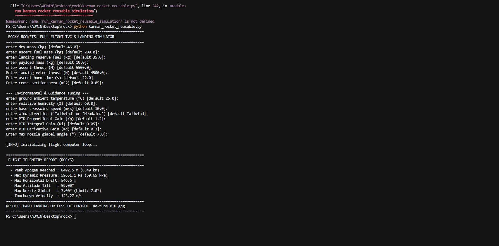

# Rocky Rockets

Ok so this project is my best attempt to create a accurate sim of the conditions faced by rockets irl but i forgot to include something which i realise now. Something so basic any rocketeer will flag - the COG and COP. Althought they are missing this code gives somewhat of a representation of the forces at max-q. I built this for terra but why i chose this in particular is cuz this reflects my real project of a VTVL rocket(electric so sustainable :) and how others should(those wishing to build a rocket) learn from my mistake of not trying out a online sim of the rocket to directly launch it(and fail).

## what is inside


* **`rock.py`** - my first version.it just calculates basic vertical ascent, gravity, and apogee.
* **`rock2.py`** - adds max q (maximum dynamic pressure) and the transonic drag spikes around the sound barrier which causes the most drag.
* **`rock3.py`** - adds full atmosphere (temperature, humidity, and temperature) integration.
* **`rock4.py`** - introduces rotational dynamics, a PID controller(based on my real rocket), and active thrust vector control (TVC) to keep the rocket stable against crosswinds.
* **`karman_reusable_rocket.py`** - the final version. It basically includes everything i built so far with some more finishing touches

## demo
here is an image of how it would look(boring i know)


## how to run

make sure you have python installed, open your terminal in the project folder, and run the script:

```powershell
python karman_reusable_rocket.py
